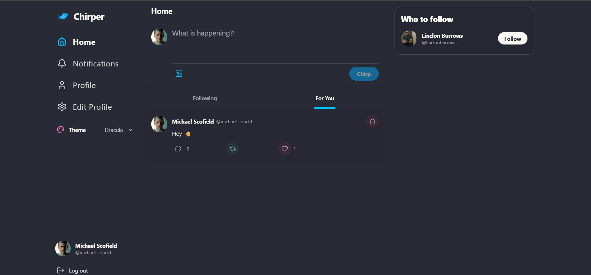
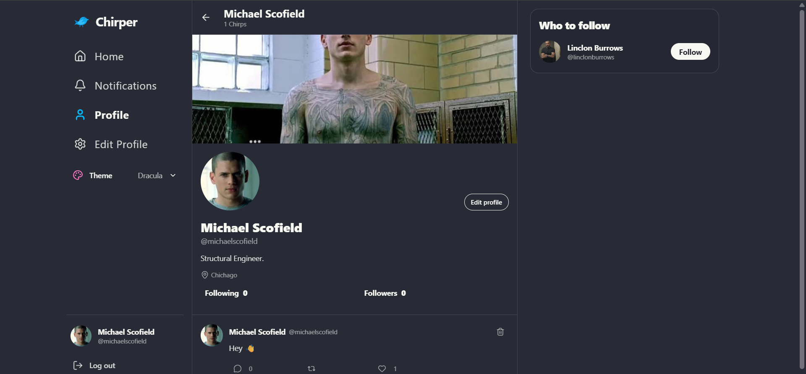
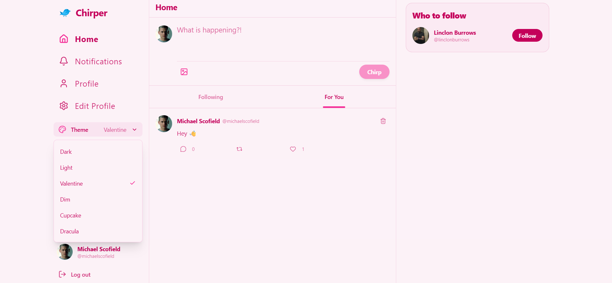

# 🐦 Chirper

A responsive microblogging app built with Next.js, React, MongoDB and Cloudinary. Share posts and images, follow people, and interact through likes, reposts and comments.

<p>
  
  
  
  
  
</p>

### 🔗 [Live Demo → chirper-xi-peach.vercel.app](https://chirper-xi-peach.vercel.app)

## 📸 Screenshots

| Feed | Profile | Themes |
|---|---|---|
|  |  |  |

## ✨ Features

- 🔐 User registration and login
- 📝 Create posts with text and images
- 👥 Follow other users
- 📰 **Following** and **For You** feeds
- ❤️ Like, 🔁 repost and 💬 comment on posts
- 🔔 Notifications for interactions
- 🖼️ Editable profile details and images
- 🎨 Persistent themes: Dark, Light, Valentine, Dim, Cupcake and Dracula
- 📱 Fully responsive design

## 🧰 Tech Stack

- **Framework:** Next.js (App Router), React
- **Database:** MongoDB with Mongoose
- **Styling:** Tailwind CSS, DaisyUI
- **Image uploads:** Cloudinary

## ⚙️ Getting Started

**Requirements:** Node.js, npm, a MongoDB database, and a Cloudinary account.

1. Clone the repo
   ```bash
   git clone https://github.com/Saadnaaa/Chirper.git
   cd Chirper
   ```
2. Install dependencies
   ```bash
   npm install
   ```
3. Create a `.env.local` file in the project root:
   ```env
   MONGO_URI=your-mongodb-connection-string
   JWT_SECRET=your-jwt-secret
   CLOUDINARY_CLOUD_NAME=your-cloud-name
   CLOUDINARY_API_KEY=your-cloudinary-api-key
   CLOUDINARY_API_SECRET=your-cloudinary-api-secret
   ```
4. Start the dev server
   ```bash
   npm run dev
   ```
5. Open [http://localhost:3000](http://localhost:3000) and register an account.

## 📜 Scripts

| Command | What it does |
|---|---|
| `npm run dev` | Start the development server |
| `npm run build` | Create a production build |
| `npm start` | Serve the production build |
| `npm run lint` | Run ESLint |

## 👤 Author

**Saad ur Rehman** · [GitHub](https://github.com/Saadnaaa) · [LinkedIn](https://www.linkedin.com/in/saadnaaa/)
